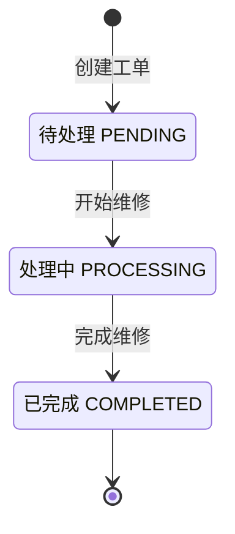
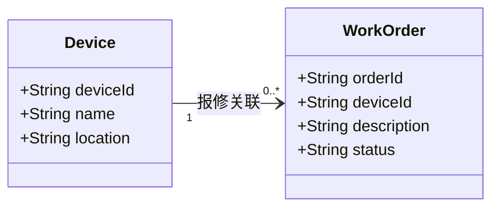

# 状态图与简单类图

## 状态图

工单创建后进入待处理（PENDING）；只有“开始维修”事件把它推进到处理中（PROCESSING），只有“完成维修”事件把它推进到已完成（COMPLETED）。已完成为本次业务终态，不提供重新打开、撤销、取消或跳过处理中的转换。

## 简单类图

`Device` 表示设备，`WorkOrder` 表示工单；一台设备对应 0 到多张工单，每张工单必须对应 1 台设备。工单的生命周期画在上面的状态图中，不与类图混为一张。

说明：
- `WorkOrder.status` 取值为 PENDING、PROCESSING、COMPLETED 三个字符串值，与状态图和程序中的枚举一致。
- `WorkOrder.deviceId` 是外键，指向 `Device.deviceId`；因此每张工单只能属于一台设备，而一台设备可以有零张（未报修）或多张（多次报修）工单。
- 两个类只描述数据结构，不在本实验中实现为完整实体类。

## 与需求的一致性检查

- [x] 中文状态与程序英文值对应：待处理=PENDING、处理中=PROCESSING、已完成=COMPLETED
- [x] 只允许两条转换：PENDING→PROCESSING、PROCESSING→COMPLETED，其余拒绝
- [x] 一台设备与多张工单关系清楚：Device "1" → WorkOrder "0..*"，并标明每张工单对应 1 台设备
- [x] 与 FR-03 的允许/拒绝转换清单逐条一致，与 T01–T04 的预期值一致
