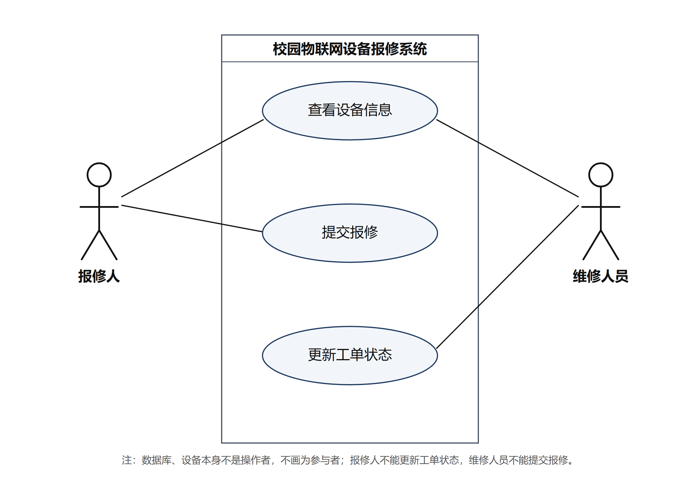

# 用例图与角色说明

## 用例图

可编辑源文件：`assets/usecase.svg`（可用 draw.io、Visio、Inkscape 或浏览器直接打开编辑，导出图与源文件内容一致）。

## 角色说明

| 参与者 | 可执行用例 | 不能执行 |
| --- | --- | --- |
| 报修人 | 查看设备信息、提交报修 | 更新工单状态（状态只能由维修人员推进） |
| 维修人员 | 查看设备信息、更新工单状态 | 提交报修（不代报修人创建工单） |

说明：系统边界内只有这三个用例；数据库、设备本身、传感器都不是操作者，不画成参与者。报修人提交报修后工单初始为 PENDING，维修人员经“开始维修”“完成维修”两次事件把工单推进到 COMPLETED。

## 图的自查

- [x] 两个参与者（报修人、维修人员）
- [x] 三个主要用例（查看设备信息、提交报修、更新工单状态）
- [x] 系统边界清楚，参与者位于边界外
- [x] 参与者与用例连接正确：查看设备信息连两个参与者，提交报修只连报修人，更新工单状态只连维修人员
- [x] 源文件与导出图内容一致
